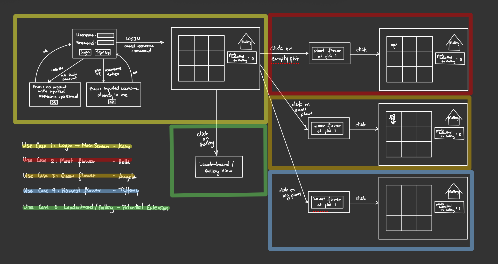

# Farming Game

## Team Information

### Team Members

- Kaho Yamamoto

- Shuting Wu

- Angela Peng

- Bella Patel

---

## Project Description

### Domain

entertainment

---

## User Stories

### 1. As a player, I want to create and log in to my account to save my progress on the game. 

### 2. As a player, I want to plant, grow, and harvest plants for my farm. [UPDATE: PLANT FLOWERS]

### 3. As a player, I want to grow my flower from the small stage to the big stage.

### 4. As a player, I want to harvest my fully grown flowers so that they are counted in my Gallery.

 

---

## Use Cases

### User story 1: Login
Use Case 1
- Name: Log in to game
- Primary actor: Player
- Precondition: Game is initially loaded
- Trigger: The player inputs username and password and clicks the "login" button
- Main success scenario:
  1. Player inputs username and password.
  2. Player clicks "login" button.
  3. System checks that an account with that information exists.
  4. System finds user information.
  5. System loads main page updated with user information.
- Extension:
  - Player inputs username and password and clicks login, but there is no user with that information so an error shows.
  - Player inputs username and password and clicks signup, but there is already a user with the inputted username, so the system shows error message.
  - Player inputs a unique username and password and clicks signup, so the system creates an account with that information and displays the login page again.
- Success outcome: The main page is displayed with user information.

### User story 2: Plant flower
Use Case 1.1
- Name: Plant a Crop
- Primary actor: Player
- Precondition: The player has at least one empty plot and at least one seed in the backpack.
- Trigger: The player clicks an empty plot.
- Main success scenario:
    1. Player clicks an empty plot.
    2. System shows the seeds in the backpack.
    3. Player chooses a seed.
    4. System plants the seed in the plot and removes one seed from the backpack.
    5. System shows the plot as planted.
- Extensions:
    - 2a. The backpack has no seeds, so the system tells the player.
    - 3a. Player cancels, so the plot stays empty.
- Success outcome: The plot contains a growing crop, and the backpack has one fewer seed.

### User Story 3: Grow flower
Use Case 3
- Name: Grow a Flower
- Primary actor: Player
- Precondition: The player is logged in and viewing their farm. The plot contains a flower in the small stage.
- Trigger: The player clicks the plot containing the small flower.
- Main success scenario:
  1. System opens a menu for the plot with 'Grow' as the only available action.
  2. Player selects 'Grow'.
  3. System changes the flower from the small stage to the big stage.
  4. System displays the big flower in the same plot.
- Extensions:
  - 2a. Player dismisses the menu. System closes the menu and returns to the farm view. The use case ends.
- Success outcome: The flower in the selected plot is in the big stage.

### User Story 4: Harvest flower
Use Case 4
- Name: Harvest a Flower
- Primary actor: Player
- Precondition: The player is logged in and the selected plot has a big flower.
- Trigger: The player clicks a plot with a big flower.
- Main success scenario:
  1. Player clicks a plot with a big flower.
  2. System shows the prompt "harvest flower at plot N".
  3. Player clicks the prompt to confirm.
  4. System sets the plot to empty and adds one to the player's plants submitted to Gallery.
  5. System shows the updated grid and the new count.
- Extensions:
  - None.
- Success outcome: The plot is empty and the player's plants submitted to Gallery has increased by one.

---

## Minimal Viable Product (MVP)

| Team Member | MVP Use Case |

| Kaho | Use Case 1 |

| Bella | Use Case 2 |

| Angela | Use Case 3 |

| Tiffany | Use Case 4: Harvest a Flower |

---

## Entities

### Plot
- Instance variables:
  - status: String ("empty", "small", or "big"), starts as "empty"
- Methods:
  - getStatus(): String
  - plant(): sets status from "empty" to "small"
  - grow(): sets status from "small" to "big"
  - harvest(): sets status from "big" to "empty"
  
### Crop
- Instance variables:
  - name: String
- Methods:
  - getName(): String

### Entities

(Add additional entities as needed.)

---

## API Usage

**API Name:** 

**Documentation:** 

**How it is used in the program:** 

---

## Design Diagrams

### UML Class Diagram

### Sequence Diagrams

---

## How to Run

[Instructions for running the program.]

---

## Notes

### Visual Project Outline

