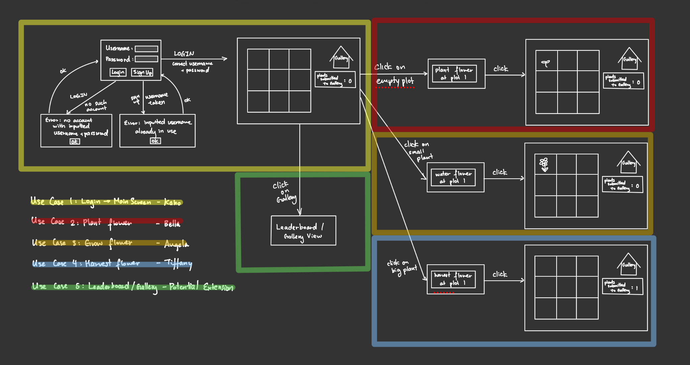

# Farming Game

## Team Information

### Team Members

- Kaho Yamamoto

- Shuting Wu

- Angela Peng

- Bella Patel

---

## Project Description

### Domain

[Project description]

---

## User Stories

### 1. As a player, I want to create and log in to my account to save my progress on the game. 

### 2. As a player, I want to plant, grow, and harvest plants for my farm. [UPDATE: PLANT FLOWERS]

### 3. As a player, I want to grow, raise, and process livestock for my farm. [UPDATE: GROW FLOWERS]

### 4. As a player, I want to trade resources with NPCs. [UPDATE: HARVEST FLOWERS]

 

---

## Use Cases

### User story 1: Login
Use Case 1
- Name: Log in to game
- Primary actor: Player
- Precondition: Game is initially loaded
- Trigger: The player inputs username and password and clicks the "login" button
- Main success scenario:
  1. Player inputs username and password.
  2. Player clicks "login" button.
  3. System checks that an account with that information exists.
  4. System finds user information.
  5. System loads main page updated with user information.
- Extension:
  - Player inputs username and password and clicks login, but there is no user with that information so an error shows.
  - Player inputs username and password and clicks signup, but there is already a user with the inputted username, so the system shows error message.
  - Player inputs a unique username and password and clicks signup, so the system creates an account with that information and displays the login page again.
- Success outcome: The main page is displayed with user information.

### User story 2: Plant flower
Use Case 1.1
- Name: Plant a Crop
- Primary actor: Player
- Precondition: The player has at least one empty plot and at least one seed in the backpack.
- Trigger: The player clicks an empty plot.
- Main success scenario:
    1. Player clicks an empty plot.
    2. System shows the seeds in the backpack.
    3. Player chooses a seed.
    4. System plants the seed in the plot and removes one seed from the backpack.
    5. System shows the plot as planted.
- Extensions:
    - 2a. The backpack has no seeds, so the system tells the player.
    - 3a. Player cancels, so the plot stays empty.
- Success outcome: The plot contains a growing crop, and the backpack has one fewer seed.

Use Case 1.2
- Name: Tend a Crop
- Primary actor: Player
- Precondition: The plot has a planted crop that has not been tended.
- Trigger: The player clicks a planted plot.
- Main success scenario:
    1. Player clicks a planted plot.
    2. System checks the current weather.
    3. System offers to water the crop (weather is Clear).
    4. Player chooses to water.
    5. System marks the crop as tended and shows the updated plot.
- Extensions:
    - 3a. Weather is Rain, so the system offers to fertilize instead of water. Continue at step 4.
    - 4a. Player cancels, so the crop stays untended.
- Success outcome: The crop is marked as tended and ready to harvest.

Use Case 1.3
- Name: Harvest a Crop
- Primary actor: Player
- Precondition: The plot has a tended crop.
- Trigger: The player clicks a tended plot.
- Main success scenario:
    1. Player clicks a tended plot.
    2. System removes the crop from the plot and adds the harvested crop to the backpack.
    3. System shows the plot as empty.
- Extensions:
    - 1a. The crop has not been tended, so the system tells the player it is not ready.
- Success outcome: The plot is empty and the backpack has the harvested crop.

### User Story 3: Grow flower

### User Story 4: Harvest flower

---

## Minimal Viable Product (MVP)

| Team Member | MVP Use Case |

| Kaho | Use Case 1 |

| Bella | Use Case 2 |

| Angela | Use Case 3 |

| Tiffany | Use Case 4 |

---

## Entities

### Entity 1
### Entity 2

(Add additional entities as needed.)

---

## API Usage

**API Name:** 

**Documentation:** 

**How it is used in the program:** 

---

## Design Diagrams

### UML Class Diagram

### Sequence Diagrams

---

## How to Run

[Instructions for running the program.]

---

## Notes

### Visual Project Outline

